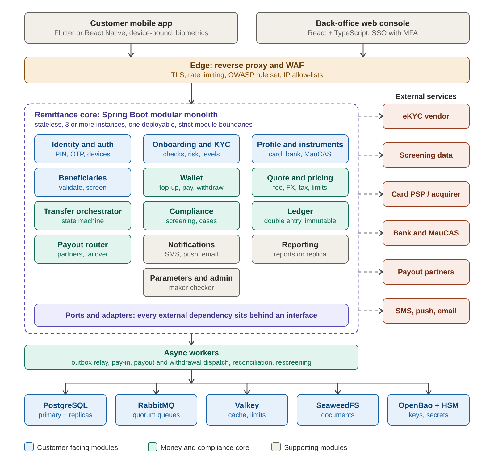
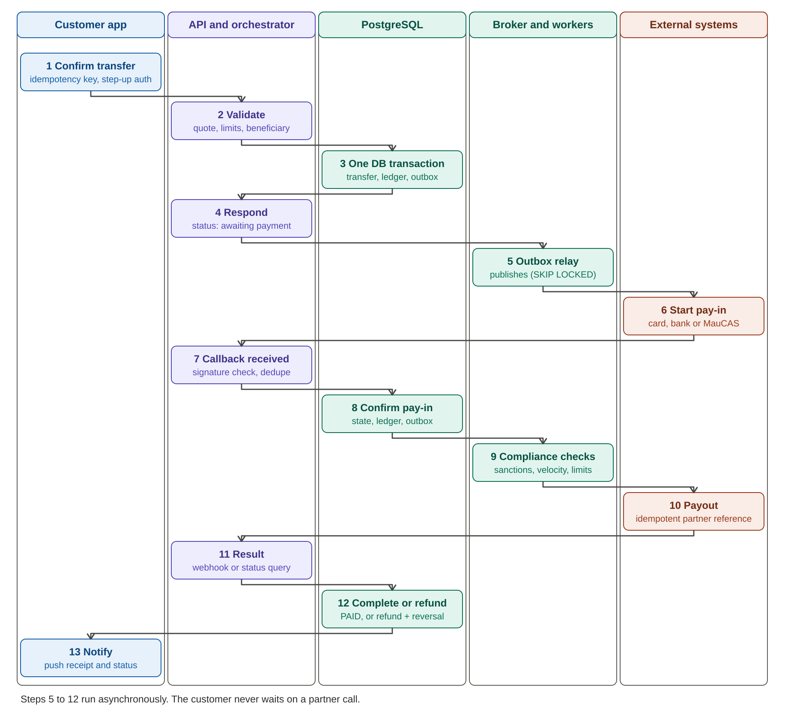
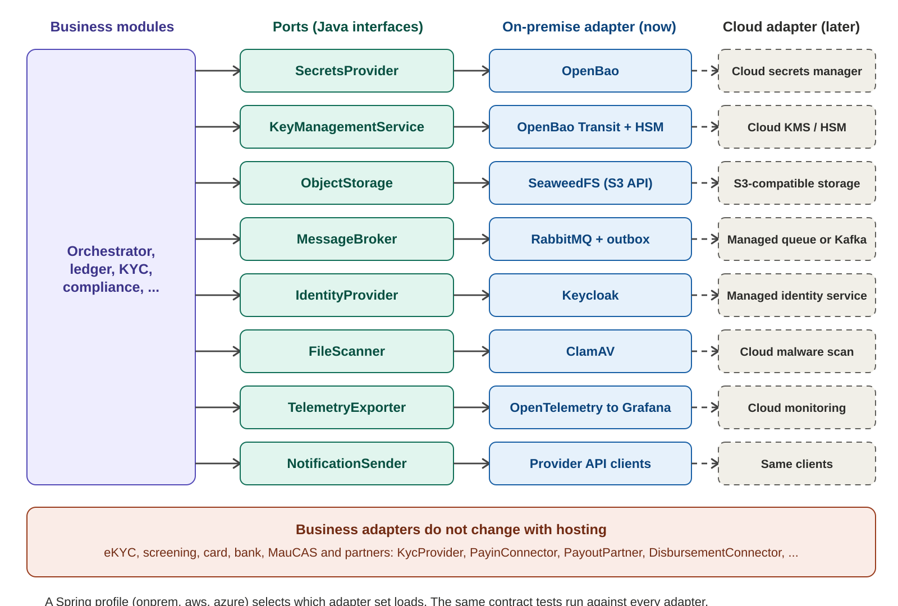
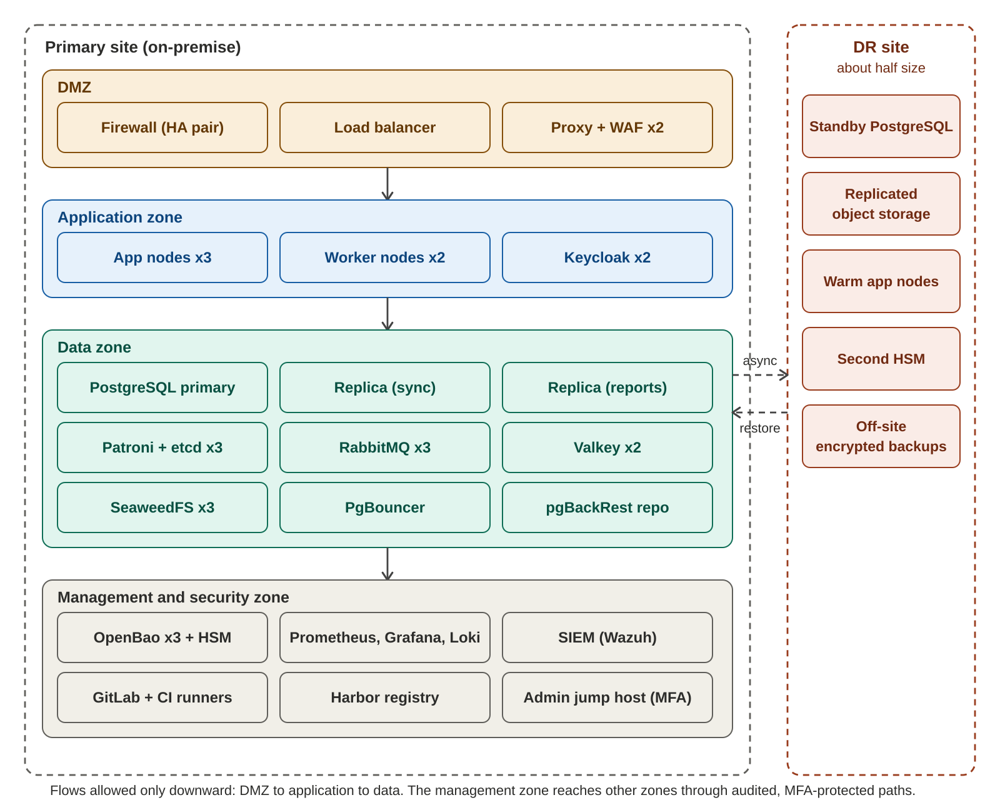

> Generated from Remittance_Platform_Technical_Design.docx by scripts/docs-sync.sh. Edit the Word file, then re-run.

**Remittance Platform**

Technical Architecture and Design Document

| **Item**        | **Detail**                                                                                                                            |
|-----------------|---------------------------------------------------------------------------------------------------------------------------------------|
| Scope           | Outbound money transfer platform from Mauritius (MUR). First corridor Madagascar (MGA); later India, Bangladesh, Nepal, South Africa. |
| Audience        | Technical lead, developers, DevOps and security engineers, solution designers                                                         |
| Version / date  | Draft 0.2, 5 November 2026 (adds the customer wallet, epic E17)                                                                       |
| Status          | For review. Items marked Proposed need a decision. Figures marked estimate or target are to be validated.                             |
| Companion files | Remittance_Platform_Functional_Design.docx, Remittance_Backlog_Epics_UserStories.xlsx, remittance_schema.sql                          |

# Contents

1. Introduction

2. Architectural Drivers

3. Architecture Overview

4. Technology Stack

5. Component Design (5.11 Customer Wallet)

6. Ports and Adapters

7. Data Architecture

8. Integration Design

9. Security Architecture

10. Deployment Architecture

11. Performance and Scalability

12. Observability and Operations

13. Testing Strategy

14. Path to Cloud

15. Delivery Plan

16. Decisions, Open Items and Risks

Appendix A. Schema Changes Needed

Appendix B. Parameter Catalogue

# 1. Introduction

## 1.1 Purpose

This document describes how the remittance platform is built: its architecture, components, data, security, deployment and delivery approach. It turns the functional design and the backlog into technical decisions the development team can implement.

## 1.2 Scope and boundaries

- In scope: customer app, back-office, core services, data, integrations, security, infrastructure, testing and delivery.

- Out of scope: licensing, regulatory policy and AML/KYC rules. These are owned by compliance and legal. The platform implements them as parameters and workflows.

- Hosting: on-premise for now, with cloud adapters designed in but not built until needed.

- Stack: Java, open source first. Paid products only where they are clearly better: HSM, eKYC, sanctions data, penetration testing and support contracts.

## 1.3 Reading guide

| **Question**                     | **Section**    |
|----------------------------------|----------------|
| How is the system structured?    | 3 and 5        |
| What technology is used and why? | 4              |
| How is money kept correct?       | 5.2, 5.3 and 7 |
| How is it secured?               | 9              |
| How does it scale and stay fast? | 11             |
| How is it deployed and operated? | 10 and 12      |
| What is built in which order?    | 15             |
| What is still undecided?         | 16             |

# 2. Architectural Drivers

## 2.1 Priorities, in order

| **\#** | **Priority**         | **What it means for the design**                                                                   |
|--------|----------------------|----------------------------------------------------------------------------------------------------|
| 1      | Security             | Defence in depth, encrypted PII, key custody in HSM, immutable audit, least privilege, secure SDLC |
| 2      | Speed                | Short customer path, asynchronous processing, partitioned ledger, caching of hot data              |
| 3      | Correctness of money | Double-entry ledger, atomic state changes, idempotency everywhere, reconciliation                  |
| 4      | Open source first    | Free, widely used components; paid only where it gives clear advantage                             |
| 5      | Portability          | Ports and adapters; on-premise now, cloud later without rewriting business code                    |
| 6      | Extensibility        | New corridors, partners and payment types added by configuration and adapters                      |

## 2.2 Volume assumptions

| **Item**    | **Assumption**                 | **Consequence**                                                                                     |
|-------------|--------------------------------|-----------------------------------------------------------------------------------------------------|
| Transfers   | 5 million a month (assumption) | About 2 a second on average; design and test for 100 a second at peaks such as payday and month-end |
| Events      | About 12 per transfer          | About 60 million a month, about 1,000 a second at peak                                              |
| Ledger rows | About 8 per transfer           | About 40 million a month, about 500 million a year: partitioning and archiving required             |
| Onboarding  | 10,000 a month (assumption)    | Small for the database; about 60 GB a month of ID images and selfies in object storage (estimate)   |
| Reports     | Heavy reads on large tables    | Served from a read replica, never the primary                                                       |

## 2.3 Quality targets (proposed)

| **Attribute**        | **Target**                                                                                                          | **How it is proven**               |
|----------------------|---------------------------------------------------------------------------------------------------------------------|------------------------------------|
| Quote latency        | 95th percentile under 300 ms                                                                                        | k6 load test                       |
| Transfer creation    | 95th percentile under 500 ms, partner time excluded                                                                 | k6 load test                       |
| Sustained throughput | 100 transfers a second for one hour with no stuck transactions                                                      | k6 load test                       |
| API availability     | 99.9%                                                                                                               | SLO dashboard                      |
| Ledger integrity     | Zero imbalance, checked daily                                                                                       | End-of-day integrity job and alert |
| Payout delivery      | 95% within 2 minutes where the partner supports instant payout (corridor dependent)                                 | Partner performance report         |
| Daily reconciliation | A full day reconciled in under 15 minutes                                                                           | Reconciliation job metrics         |
| Data loss            | No committed ledger entry lost on database failover                                                                 | Failover test under load           |
| Recovery             | Automatic database failover inside the site; disaster recovery to second site within a target set with the business | Quarterly drills                   |

> *All targets are proposals. They need agreement with the business and a load test before launch.*

# 3. Architecture Overview

## 3.1 Style

The platform is a modular monolith with asynchronous workers, built with ports and adapters (hexagonal architecture). One deployable application contains well-separated modules. Anything slow or external runs in workers fed by a queue.

| **Option**                 | **Strengths**                                                                                                                               | **Weaknesses**                                                                      | **Decision**                                  |
|----------------------------|---------------------------------------------------------------------------------------------------------------------------------------------|-------------------------------------------------------------------------------------|-----------------------------------------------|
| Modular monolith (chosen)  | One database transaction covers state change and ledger; fewer failure modes; simple operations for a small team; clear path to split later | Needs discipline to keep module boundaries                                          | Chosen. Boundaries enforced by tests          |
| Microservices from day one | Independent scaling and deployment                                                                                                          | Distributed transactions, many moving parts, heavy operations load, slower delivery | Rejected for now                              |
| Serverless / cloud-native  | Elastic, managed                                                                                                                            | Conflicts with the on-premise requirement                                           | Rejected for now; adapters keep the door open |

*Figure 1. Logical architecture*

## 3.2 Modules

| **Module**              | **Responsibility**                                                                           | **Owns data**                                                 | **Epics** |
|-------------------------|----------------------------------------------------------------------------------------------|---------------------------------------------------------------|-----------|
| Identity and auth       | Customer login, PIN, OTP, device binding, step-up, sessions                                  | credentials, devices, sessions                                | E02       |
| Onboarding and KYC      | Application flow, eKYC orchestration, checks, risk score, KYC level                          | kyc applications, documents refs                              | E01       |
| Profile and instruments | Profile, limits view, saved cards, bank accounts, MauCAS links                               | profile, payment instruments                                  | E03, E04  |
| Beneficiaries           | Corridor-driven forms, validation, screening, lifecycle                                      | beneficiaries, field values                                   | E05       |
| Quote and pricing       | Fee, commission, FX margin, tax, rate lock, limit pre-check                                  | quotes, rate snapshots                                        | E06       |
| Transfer orchestrator   | State machine, idempotency, outbox, step handlers                                            | transactions, events, outbox                                  | E07, E08  |
| Compliance              | Sanctions and PEP screening, rules, cases, rescreening, blocklists                           | cases, screening results                                      | E05, E09  |
| Wallet                  | Wallet lifecycle, top-up, pay from wallet, withdrawal to own bank account, holds, statements | wallets, wallet holds, wallet operations, withdrawal accounts | E17       |
| Ledger                  | Double-entry postings, balances, integrity checks                                            | accounts, ledger entries                                      | E12       |
| Payout router           | Corridor and channel rules, partner selection, failover, circuit breakers                    | partner payouts, routing rules                                | E15       |
| Notifications           | Templates, event mapping, delivery tracking                                                  | templates, delivery log                                       | E13       |
| Reporting               | Reports and exports on the read replica                                                      | report definitions                                            | E10       |
| Parameters and admin    | Parameters, maker-checker, versioning, switches, back-office RBAC                            | parameters, audit                                             | E11, E14  |

## 3.3 Module rules

- A module never reads or writes another module's tables. It calls the other module's public interface or consumes its events.

- Boundaries are checked in the build with Spring Modulith and ArchUnit tests, so a violation fails the pipeline.

- Business code imports no infrastructure classes. It uses ports (section 6).

- A module can be extracted into its own service later because its interface and data are already separate.

## 3.4 Transfer flow at a glance

*Figure 2. End-to-end transfer flow across components*

The customer call ends at step 4. Everything after it runs asynchronously, so a slow partner never slows the customer API.

# 4. Technology Stack

Versions are not fixed in this document. The policy is the current long-term-support release of each component, pinned in the build and upgraded on a schedule. Licence terms of open-source projects change over time, so each choice below should be re-checked before adoption.

| **Layer**                      | **Choice**                                                                                                                         | **Alternatives**               | **Why**                                                                               |
|--------------------------------|------------------------------------------------------------------------------------------------------------------------------------|--------------------------------|---------------------------------------------------------------------------------------|
| Language, runtime              | Java (current LTS), Eclipse Temurin                                                                                                | Kotlin on the same runtime     | Agreed. Mature for payments, large talent pool                                        |
| Framework                      | Spring Boot, Spring Security, Spring Modulith                                                                                      | Quarkus                        | Mature ecosystem, strong security and module tooling                                  |
| Data access                    | JPA for ordinary entities; jOOQ or plain JDBC for ledger and state changes                                                         | JPA only                       | Explicit SQL on the money path gives control and speed                                |
| Migrations                     | Flyway Community                                                                                                                   | Liquibase                      | Simple, SQL-first, open licence                                                       |
| Resilience                     | Resilience4j                                                                                                                       | Hand-written                   | Timeouts, retries, circuit breakers, bulkheads                                        |
| Crypto                         | Google Tink                                                                                                                        | JCA directly                   | Safe defaults for envelope encryption                                                 |
| Database                       | PostgreSQL, native partitioning, pg_partman                                                                                        | YugabyteDB, commercial engines | Handles this volume on one primary; paid engines add cost, not need                   |
| HA, pooling, backup            | Patroni + etcd, PgBouncer, pgBackRest                                                                                              | Managed service (later)        | Automatic failover, connection pooling, point-in-time recovery                        |
| Broker                         | RabbitMQ with quorum queues, fed by the Postgres outbox                                                                            | Kafka, NATS JetStream          | Retries, dead-letter queues, low latency; Kafka only if streaming or replay is needed |
| Cache                          | Valkey                                                                                                                             | Redis, Hazelcast               | Fully open source; rate limits, sessions, quote cache. Never a source of truth        |
| Secrets and keys               | OpenBao with HSM-backed master key                                                                                                 | HashiCorp Vault Enterprise     | Open licence, same model                                                              |
| Object storage                 | SeaweedFS or Ceph (S3 API)                                                                                                         | MinIO                          | Avoids licence risk                                                                   |
| Staff identity                 | Keycloak                                                                                                                           | Authentik, Okta                | Open source, SSO, MFA, roles                                                          |
| Edge                           | Traefik or Nginx with Coraza or ModSecurity and the OWASP rule set                                                                 | Commercial WAF                 | Sufficient on-premise                                                                 |
| File scanning                  | ClamAV                                                                                                                             | Commercial scanners            | Free, scans uploaded documents                                                        |
| Mobile                         | Flutter (or React Native)                                                                                                          | Native Kotlin and Swift        | One codebase, secure storage and biometrics through plugins                           |
| Back-office UI                 | React with TypeScript                                                                                                              | Angular, Vue                   | Large ecosystem                                                                       |
| Reports                        | Apache Superset or Metabase OSS on a read replica                                                                                  | Power BI                       | Free, role-based access                                                               |
| Observability                  | OpenTelemetry, Prometheus, Grafana, Loki, Tempo, Alertmanager                                                                      | Datadog, Elastic               | Free and sufficient                                                                   |
| SIEM                           | Wazuh                                                                                                                              | Splunk, Elastic Security       | Free, active community                                                                |
| Containers                     | Docker or Podman with Compose for dev; k3s or RKE2 for staging and production                                                      | Docker Swarm, Nomad            | Standard, scales                                                                      |
| CI/CD                          | GitLab CE or Gitea with Woodpecker; Argo CD; Harbor registry                                                                       | Jenkins, JFrog                 | Free, self-hosted                                                                     |
| Code and supply-chain security | SonarQube Community, Semgrep OSS, SpotBugs with FindSecBugs, OWASP Dependency-Check, Trivy, Gitleaks, OWASP ZAP, CycloneDX, cosign | Commercial suites              | Covers static, dependency, secret, image and dynamic testing                          |
| Testing                        | JUnit 5, Testcontainers, Pact, WireMock, k6                                                                                        | \-                             | Real databases in tests, contract tests for partners, load tests                      |
| Infrastructure as code         | Ansible now; Terraform or OpenTofu when cloud arrives                                                                              | \-                             | Reproducible environments                                                             |

## 4.1 Where paid products are the better choice

| **Item**                                              | **Why paid**                                                                            |
|-------------------------------------------------------|-----------------------------------------------------------------------------------------|
| Network HSM for production key custody                | Certified hardware and audit evidence that software keys cannot provide                 |
| eKYC vendor                                           | Liveness, document coverage and fraud models; no open-source equivalent at this quality |
| Sanctions and PEP data                                | Lists must be current and licensed                                                      |
| Independent penetration test                          | Required before real money flows; must be independent                                   |
| Support contracts for the database and identity layer | Faster resolution during incidents                                                      |

# 5. Component Design

## 5.1 API and request handling

- REST with OpenAPI, versioned in the path (/v1). Errors use a standard problem format with a stable error code.

- Every state-changing call carries an Idempotency-Key header. The first result is stored and returned for any repeat.

- Every request has a correlation ID that flows into logs, traces and partner calls. The transaction ID is added once it exists.

- Strict input validation with Bean Validation; unknown fields rejected; amounts always integers in the minor unit.

- Rate limits at the edge and in the application, tighter for login, OTP and onboarding endpoints.

- Deny-by-default authorisation. Each endpoint declares the role or scope it needs, and sensitive actions require step-up authentication.

## 5.2 Transfer orchestrator

The orchestrator owns the transaction state machine. A transfer is created in one database transaction that writes the transaction, its first ledger lines and an outbox event together. Later steps run in workers triggered by events.

| **State**                       | **Meaning**                                     | **Next states**                    |
|---------------------------------|-------------------------------------------------|------------------------------------|
| CREATED                         | Transfer started                                | QUOTED                             |
| QUOTED                          | Rate locked, waiting for customer confirmation  | PAYIN_PENDING, EXPIRED             |
| PAYIN_PENDING                   | Collection started with PSP, bank or MauCAS     | PAYIN_CONFIRMED, FAILED            |
| PAYIN_CONFIRMED                 | Funds received and ledgered                     | COMPLIANCE_CHECK                   |
| COMPLIANCE_CHECK                | Sanctions, velocity and limit rules running     | PAYOUT_SENT, MANUAL_REVIEW         |
| MANUAL_REVIEW                   | Held for a compliance decision                  | PAYOUT_SENT, REFUND_PENDING        |
| PAYOUT_SENT                     | Sent to payout partner                          | PAID, PAYOUT_RETRY, REFUND_PENDING |
| PAYOUT_RETRY                    | Retry or alternate partner after a safe failure | PAYOUT_SENT, REFUND_PENDING        |
| REFUND_PENDING                  | Money being returned to the customer            | REFUNDED                           |
| PAID, REFUNDED, FAILED, EXPIRED | Terminal states                                 | none                               |

**Rules the implementation must follow:**

- All transitions go through one function (transition_tx in the SQL schema). It locks the row, checks the allowed_transitions table, updates the status and writes a transaction_events row.

- The state change, ledger postings and outbox event are committed in the same database transaction. Nothing is published before the commit.

- Handlers are idempotent. Events are delivered at least once, so each handler checks the current state before acting.

- A payout timeout leaves the result UNKNOWN. The system queries the partner by reference before any retry. It never resends blindly, because that can pay twice.

- Stuck transactions are found by a scheduled job (state and age) and shown in the support console and in reports.

- A transfer paid from the wallet moves from QUOTED through PAYIN_PENDING to PAYIN_CONFIRMED inside the same database transaction that debits the wallet (section 5.11).

- A failure after pay-in leads to a refund through the same state machine, never to a manual database edit.

## 5.3 Ledger

The ledger is an immutable double-entry record. Every money movement is a ledger transaction made of balanced debit and credit lines. Corrections are new reversing entries.

| **Event**                 | **Debit**                                                                | **Credit**                                              | **Notes**                                                    |
|---------------------------|--------------------------------------------------------------------------|---------------------------------------------------------|--------------------------------------------------------------|
| Pay-in confirmed          | COLLECTION account for the payment type or MauCAS mode (A)               | PAYOUT_IN_TRANSIT (P), FEE_REVENUE (F), TAX_PAYABLE (T) | A = P + F + T. T is zero or skipped when tax is disabled     |
| Payout sent, MUR leg      | PAYOUT_IN_TRANSIT (P)                                                    | FX_POSITION_MUR (P minus M), FX_REVENUE (M)             | M is the FX margin in MUR                                    |
| Payout sent, MGA leg      | FX_POSITION_MGA (R)                                                      | PREFUNDING_MG (R)                                       | R is the amount paid out in MGA                              |
| Pay-in from the wallet    | WALLET_CUSTOMER (A)                                                      | PAYOUT_IN_TRANSIT (P), FEE_REVENUE (F), TAX_PAYABLE (T) | Same split as other pay-ins; wallet postings in section 5.11 |
| Payout rejected or failed | Reversal of the two payout postings                                      | Reversal of the two payout postings                     | Linked by reverses_id                                        |
| Refund to customer        | PAYOUT_IN_TRANSIT; FEE_REVENUE and TAX_PAYABLE as the refund policy says | COLLECTION account (A)                                  | Policy is a parameter                                        |

> *Each currency must balance by itself, as the database trigger enforces. A payout therefore uses two legs through FX position accounts, one per currency. The FX_POSITION accounts are not yet in the seed data of remittance_schema.sql and must be added (Appendix A).*

- Hot accounts: one row per balance would make every transfer fight for the same lock. Balances are computed from entries plus periodic snapshots. Very busy accounts are split into sub-accounts (for example per hour or per shard) and summed on read.

- Partitioning: ledger_entries and transaction_events are partitioned by month. Old partitions are detached and archived after the retention period set by compliance.

- Integrity: an end-of-day job checks that debits equal credits per currency and that the sum of snapshots matches the entries. Any difference raises a critical alert.

- Tax: the TAX_PAYABLE account and the tax line always exist. The TAX_ENABLED parameter only decides whether the amount is non-zero for new transfers.

- Money type: amounts are 64-bit integers in the minor unit. No floating point anywhere in money code.

## 5.4 Pricing, FX and parameters

A quote is computed in a fixed order and then stored unchanged. Changing a parameter later never alters an existing quote.

| **Step** | **Calculation**                                                                        | **Source**                                         |
|----------|----------------------------------------------------------------------------------------|----------------------------------------------------|
| 1        | Take the send amount or the receive amount                                             | Customer input                                     |
| 2        | Get the market rate from the rate source; reject if older than the staleness threshold | Rate service, parameter threshold                  |
| 3        | Apply the FX margin within its guardrails to get the customer rate                     | Parameter by corridor and amount band              |
| 4        | Compute the fee and commission from the fee tables                                     | Parameter by corridor, channel, payment type, tier |
| 5        | Compute tax on the configured base when TAX_ENABLED is true                            | Parameter                                          |
| 6        | Check per-transaction, daily and monthly limits for the customer's KYC level           | Parameter and usage counters                       |
| 7        | Store the quote with an expiry time and return the breakdown                           | quotes table                                       |

- Parameters are typed and have a scope. Precedence: customer segment, then payment type, then channel, then corridor, then global.

- Every change is made by one person and approved by another. The parameters table rejects approval by the creator (approved_by must differ from created_by).

- Changes have an effective date and a version. Rollback creates a new version; nothing is overwritten.

- Services read parameters through a cache with a short time-to-live and event-based invalidation, so the hot path never queries the table on every request.

- No fee, limit, margin, tax or monetary value is written in code. Values are seeded per environment and changed only through the developer-only menu.

- MAUCAS_ENABLED and MAUCAS_MODE select the MauCAS behaviour. TAX_ENABLED selects tax behaviour. All three are in the seed data.

## 5.5 Onboarding and KYC

- A KycProvider port wraps the eKYC vendor: create applicant, upload or link documents, read result, receive webhook.

- Documents are uploaded straight from the app to object storage with short-lived signed URLs. The API servers never carry the files. Each upload is virus-scanned before use.

- Automated checks run as an asynchronous pipeline: eligibility, document authenticity and expiry, face match and liveness, duplicate identity, sanctions and PEP, device and phone risk.

- Each check returns PASS, REVIEW or FAIL. The decision rule is in parameters. Any REVIEW creates a compliance case; any FAIL rejects.

- The risk score and its factors are stored. The KYC level it produces sets the limits.

- Personal data is stored encrypted (section 7.3). Screens for staff show masked values unless the role allows more.

## 5.6 Beneficiaries and compliance screening

- Beneficiary forms are generated from per-corridor field definitions (versioned JSON schema), so adding a country needs no code change.

- Creating or changing a sensitive field puts the beneficiary in PENDING_SCREENING. A ScreeningProvider port screens the name and identifiers.

- A clear result makes the beneficiary ACTIVE; a hit makes it PENDING_REVIEW and opens a compliance case; a decision makes it ACTIVE or BLOCKED.

- A scheduled job rescreens customers and beneficiaries when the sanctions lists change. New hits create cases.

- Rules such as the new-beneficiary cooling-off limit and shared-account detection run in the compliance module and read thresholds from parameters.

## 5.7 Pay-in connectors

All collection methods implement one PayinConnector port: createPayment, getStatus, parseWebhook, refund. The orchestrator does not know which one it is calling.

| **Connector**             | **How it works**                                                                                                                        | **Ledger account**        |
|---------------------------|-----------------------------------------------------------------------------------------------------------------------------------------|---------------------------|
| Card (PSP)                | PSP-hosted fields and 3-D Secure. Only a token, brand, last four digits and expiry are stored. Card numbers never reach the platform    | COLLECTION_CARD           |
| Bank transfer             | Account added and verified; collection by transfer or direct debit; confirmed by callback or statement matching                         | COLLECTION_BANK           |
| MauCAS, direct mode       | Platform connects to MauCAS as a participant; payment request per transfer; confirmation by callback or status query                    | COLLECTION_MAUCAS_DIRECT  |
| MauCAS, sponsor-bank mode | Platform connects to a sponsor bank, which connects to MauCAS; same interface to the orchestrator                                       | COLLECTION_MAUCAS_SPONSOR |
| Wallet                    | Internal connector. No external call: the wallet is locked, the available balance checked and debited in the orchestrator's transaction | WALLET_CUSTOMER           |

The MauCAS participation model is not decided. Both connectors are built and MAUCAS_MODE chooses the active one. Switching applies to new payments only; payments in progress finish in the mode they started in. A separate MAUCAS_ENABLED switch turns MauCAS on or off.

## 5.8 Payout partners and routing

- A PayoutPartner port defines sendPayout, getStatus, parseWebhook, getBalance and validateBeneficiary. Each partner is an adapter, and adding one does not change the orchestrator.

- A corridor table and a payout_methods table define which channels exist per country, with limits, cut-offs and required fields. Launching a corridor is configuration plus an adapter check.

- The router picks a partner by corridor, channel, cost, recent success rate and speed, with a priority list and failover.

- Each partner has its own queue, concurrency limit, timeout, retry policy and circuit breaker. A slow partner can exhaust only its own capacity.

- Before sending, the router checks the partner's prefunded balance. If it is below the threshold, the corridor is paused and operations are alerted.

- A mock partner simulates delays, timeouts, duplicate webhooks and rejections, and is used in CI.

## 5.9 Notifications, reporting and reconciliation

- Notifications: events map to templates in several languages. Status messages use push and in-app notifications. SMS is limited to registration, new device and recovery, because SMS cost grows with volume. Delivery receipts are stored, with fallback to another channel for critical messages.

- Reporting: all reports read from a replica through dedicated views, with masked personal data by default and role-based access. Exports are logged.

- Reconciliation: daily set-based SQL jobs compare pay-in provider settlements, the ledger and partner statements, by corridor and partner. Breaks are stored, assigned and aged in a break-management screen.

## 5.10 Back-office and access control

- Staff sign in through Keycloak with MFA. Roles: compliance officer, support agent, finance analyst, developer or admin.

- Sensitive actions need four-eyes approval: refunds, manual payouts, limit changes, parameter changes.

- Support sees masked data. Full values are visible only to roles that need them, and each reveal is logged.

- The parametrisation menu is visible only to the developer or admin role, with MFA and an IP allow-list.

## 5.11 Customer wallet

Each customer can hold one MUR wallet. It is funded by card, bank or MauCAS, spent on transfers, and withdrawn to a verified bank account in the customer's own name. The wallet module owns the wallet tables. The ledger stays the single source of truth for balances, and WALLET_ENABLED switches the feature on globally or per segment.

| **Operation**    | **Design**                                                                                                                                                                                                                                                                                                                                                                                                  |
|------------------|-------------------------------------------------------------------------------------------------------------------------------------------------------------------------------------------------------------------------------------------------------------------------------------------------------------------------------------------------------------------------------------------------------------|
| Top-up           | A wallet_operation (TOPUP) goes through the PayinConnector of the chosen method. The wallet is credited only when the pay-in is confirmed: state change, ledger posting and outbox event in one transaction. Card-funded amounts get a WITHDRAWAL_BLOCK hold for the holding period                                                                                                                         |
| Pay a transfer   | WalletPayinConnector runs inside the orchestrator's transaction: lock the wallet row (SELECT ... FOR UPDATE), compute available = posted - active holds, reject if short, post the debit, move the transfer to PAYIN_CONFIRMED and write the outbox event. One commit, so the customer cannot spend the same money twice                                                                                    |
| Withdrawal       | A wallet_operation (WITHDRAWAL) locks the wallet, checks the available balance and posts Dr WALLET_CUSTOMER / Cr WITHDRAWAL_IN_TRANSIT, FEE_REVENUE, TAX_PAYABLE. A worker sends it through the DisbursementConnector port (bank transfer or MauCAS credit). PAID posts Dr WITHDRAWAL_IN_TRANSIT / Cr SETTLEMENT_BANK. FAILED or RETURNED reverses. A timeout leaves it UNKNOWN until the status is queried |
| Refund to wallet | Refund step of the transfer state machine with target WALLET; posting Dr PAYOUT_IN_TRANSIT (plus fee and tax per policy) / Cr WALLET_CUSTOMER                                                                                                                                                                                                                                                               |
| Holds            | wallet_holds rows (type, reference, amount, expires_at, status). Types: WITHDRAWAL_PENDING, WITHDRAWAL_BLOCK (card-funded), COMPLIANCE. Expired holds are released by a scheduled job                                                                                                                                                                                                                       |
| Statuses         | Wallet: ACTIVE, FROZEN (no debits), DORMANT, CLOSED. Top-up: PENDING, COMPLETED, FAILED. Withdrawal: REQUESTED, IN_REVIEW, SENT, PAID, FAILED, RETURNED, UNKNOWN. Transitions are table-driven, as for transfers                                                                                                                                                                                            |

- Ledger: one WALLET_CUSTOMER liability sub-account per wallet (created on wallet opening), plus shared WITHDRAWAL_IN_TRANSIT and SETTLEMENT_BANK accounts. The wallet's posted balance is read from the ledger and its latest snapshot.

- Concurrency: the lock is per wallet, so it does not create a hot spot. Debits use the wallet row lock plus a version column. A concurrency test fires parallel debits and checks that the balance never goes negative.

- Idempotency: every top-up, debit and withdrawal carries an Idempotency-Key. The unique constraint on (wallet_id, idempotency_key) makes a repeat return the first result.

- Safeguarding reconciliation: a daily job compares the sum of all WALLET_CUSTOMER balances with the safeguarding bank account statement. A shortfall is a critical alert and a reconciliation break.

- Controls: withdrawals go only to verified own-name accounts after a cooling-off period. Monitoring rules flag a top-up withdrawn without use, rapid cycles and many cards. Freeze and manual adjustments need four-eyes approval and are new ledger entries.

- Licensing and safeguarding requirements for stored value are for compliance and legal to confirm. The design keeps the feature behind WALLET_ENABLED until they do.

# 6. Ports and Adapters

Business code depends on interfaces. Each infrastructure service sits behind an adapter, and a Spring profile selects the adapter set. The on-premise adapters are built now. Cloud adapters are added later behind the same interfaces.

*Figure 3. Ports with on-premise adapters now and cloud adapters later*

**Example of the pattern:**

> public interface SecretsProvider {
>
> String get(String path);
>
> }
>
> @Profile("onprem")
>
> @Component
>
> class OpenBaoSecretsProvider implements SecretsProvider {
>
> public String get(String path) { /\* call OpenBao \*/ }
>
> }
>
> // later, added without touching business code:
>
> @Profile("aws")
>
> @Component
>
> class CloudSecretsProvider implements SecretsProvider { ... }

- Each port has a contract test suite. Every adapter must pass the same suite, so behaviour stays identical when the hosting changes.

- Business adapters (eKYC, screening, PSP, bank, MauCAS, payout partners) do not change with hosting, and they follow the same rule.

- Adapters are the only place that holds vendor SDK code, credentials handling and vendor-specific error mapping.

# 7. Data Architecture

## 7.1 Logical data areas

| **Area** | **Contents**                                                                        | **Access**                                                              |
|----------|-------------------------------------------------------------------------------------|-------------------------------------------------------------------------|
| pii      | Names, phone, addresses, ID references, beneficiary account data (encrypted fields) | Identity, onboarding and beneficiary modules only; separate credentials |
| core     | Transactions, events, quotes, instruments, partner payouts, webhook inbox, outbox   | Orchestrator and related modules                                        |
| wallet   | Wallets, wallet holds, wallet operations, withdrawal accounts                       | Wallet module only; balances come from the ledger                       |
| ledger   | Accounts, ledger transactions, entries, snapshots                                   | Ledger module writes; others read through views                         |
| audit    | Append-only, hash-chained audit records                                             | Insert only; read by compliance and security roles                      |
| config   | Parameters, corridors, payout methods, field definitions, templates                 | Admin module writes through maker-checker                               |

## 7.2 Current schema and what is planned

remittance_schema.sql already contains: customers, beneficiaries, quotes, transactions (with tax_amount), transaction_events, allowed_transitions with the transition_tx function, partner_payouts, webhook_inbox, accounts (including TAX_PAYABLE and both MauCAS collection accounts), ledger_transactions, ledger_entries with immutability and balance triggers, the account_balances view, and the parameters table with maker-checker. The additions needed are listed in Appendix A.

## 7.3 Protecting personal data

| **Control**                | **Design**                                                                                                                                                                                        |
|----------------------------|---------------------------------------------------------------------------------------------------------------------------------------------------------------------------------------------------|
| Field-level encryption     | ID numbers, document references, phone numbers and beneficiary account data are encrypted in the application with Tink, using data keys wrapped by a master key held in OpenBao backed by the HSM |
| Searchable fields          | A keyed hash (blind index) is stored beside an encrypted value so lookups work without decrypting                                                                                                 |
| Key hierarchy              | Master key in HSM, then key-encryption keys per data class, then data keys per record or batch. Rotation re-wraps data keys without re-encrypting all data                                        |
| Disk and backup encryption | Full-disk encryption on servers; backups encrypted before they leave the host                                                                                                                     |
| Masking                    | Support and report views show masked values; unmasking is role-based and logged                                                                                                                   |
| Logs                       | A masking layer removes personal data and secrets before anything is written to logs                                                                                                              |
| Current schema gap         | In remittance_schema.sql, customers.phone is plain text. Before production it must become an encrypted value plus a blind index                                                                   |

## 7.4 Outbox and partitioning

Events are written to an outbox table in the same transaction as the state change. A relay process publishes them to the broker. Several relay workers can run in parallel without duplicates by locking batches with SKIP LOCKED.

> CREATE TABLE outbox (
>
> id bigserial PRIMARY KEY,
>
> aggregate_id uuid NOT NULL, -- transaction id, keeps per-transfer ordering
>
> event_type text NOT NULL,
>
> payload jsonb NOT NULL,
>
> created_at timestamptz NOT NULL DEFAULT now(),
>
> published_at timestamptz
>
> );
>
> CREATE INDEX idx_outbox_unpublished ON outbox(id) WHERE published_at IS NULL;
>
> -- relay, inside one transaction:
>
> -- SELECT \* FROM outbox WHERE published_at IS NULL
>
> -- ORDER BY id LIMIT 100 FOR UPDATE SKIP LOCKED;
>
> -- publish to the broker with publisher confirms;
>
> -- UPDATE outbox SET published_at = now() WHERE id = ANY(:ids); COMMIT;
>
> -- delivery is at least once, so every consumer is idempotent

- ledger_entries and transaction_events: monthly range partitions created ahead of time by pg_partman.

- Outbox: published rows are deleted or partitioned away on a schedule to keep the table small.

- Indexes serve known access paths only: by transaction, by account and time, by customer and time, by status for stuck-item jobs.

- Reports run on the asynchronous replica. The synchronous replica exists for zero data loss on failover.

## 7.5 Audit integrity

Audit records are append-only and each one stores a hash of the previous record, so removing or changing an entry breaks the chain and is detected by a scheduled verification job. Audit data is also shipped to write-once storage.

# 8. Integration Design

| **External system**                   | **Port**              | **Direction**                       | **Safety rules**                                           |
|---------------------------------------|-----------------------|-------------------------------------|------------------------------------------------------------|
| eKYC vendor                           | KycProvider           | Calls out; webhook in               | Signed webhooks; results stored; manual fallback path      |
| Sanctions and PEP data                | ScreeningProvider     | Calls out; list updates in          | Hit means a case, never an automatic pass                  |
| Card PSP or acquirer                  | PayinConnector        | Calls out; webhook in               | Hosted fields only; 3-D Secure; tokens only                |
| Bank                                  | PayinConnector        | Calls out; statement or callback in | Name match; statement reconciliation                       |
| MauCAS (direct or sponsor bank)       | PayinConnector        | Calls out; callback in              | Mode by parameter; per-mode ledger accounts                |
| Payout partners                       | PayoutPartner         | Calls out; webhook in               | Idempotent reference; status query before retry            |
| Bank or MauCAS for wallet withdrawals | DisbursementConnector | Calls out; callback or statement in | Own-name verified accounts only; status query before retry |
| Rate source                           | RateProvider          | Calls in                            | Staleness guard; second source as cross-check              |
| SMS, push, email                      | NotificationSender    | Calls out; receipts in              | No sensitive data in SMS; fallback channel                 |

## 8.1 Rules for every external call

- Timeouts on every call, set per partner as parameters. Retries use exponential backoff with jitter, only where the call is safe to repeat.

- Every outgoing request carries an idempotency reference that the partner supports, or a lookup is done first.

- Circuit breakers and bulkheads per partner. Opening a breaker pauses that partner or corridor and raises an alert.

- Responses are mapped to a small internal set of outcomes: success, rejected, retryable failure, unknown.

- Raw partner responses are stored (partner_payouts.raw_response) for investigation, with sensitive fields protected.

## 8.2 Webhook handling

| **Step** | **Action**                                                                                         |
|----------|----------------------------------------------------------------------------------------------------|
| 1        | Accept only from allow-listed source addresses and over TLS                                        |
| 2        | Verify the signature and the timestamp; reject replays                                             |
| 3        | Insert into webhook_inbox keyed by source and external ID; a duplicate is acknowledged and ignored |
| 4        | Return success quickly; process asynchronously                                                     |
| 5        | Process in a database transaction: state change, ledger and outbox together                        |
| 6        | Mark processed; unprocessable items go to a dead-letter queue and appear in the support console    |

# 9. Security Architecture

## 9.1 Principles

- Defence in depth: edge, application, data and management layers each enforce their own controls.

- Least privilege for people, services and database accounts. Deny by default.

- Zero trust inside the platform: services authenticate to each other (mTLS or signed tokens) even in the same zone.

- Secure by default: safe configurations in templates, no secrets in code, no debug features in production.

- Everything important is logged, and logs cannot be changed by the people they describe.

- Target OWASP ASVS Level 2 and track it as a checklist in the repository.

## 9.2 Main threats and controls

| **Threat**                          | **Controls**                                                                                                                |
|-------------------------------------|-----------------------------------------------------------------------------------------------------------------------------|
| Account takeover                    | PIN hashed with Argon2id, device binding, new-device verification, step-up for sensitive actions, lockout, anomaly rules    |
| SIM swap or OTP interception        | Biometric device approval for transfers, change-of-phone flag with temporary limits, SMS only for low-risk steps            |
| OTP pumping and bot abuse           | Rate limits per number, device and address; bot protection at the edge; cost alerts on SMS volume                           |
| Forged webhooks                     | Signatures, timestamps, allow-listed addresses, deduplication                                                               |
| Wallet double spend                 | Wallet row lock and version check, available balance computed with holds, idempotency keys, concurrency tests               |
| Wallet misuse to move illicit funds | Withdrawals only to verified own-name accounts, cooling-off, card-funded holding period, monitoring rules, compliance cases |
| Double payout                       | Idempotent references, UNKNOWN state with status query before retry, unique constraints, reconciliation                     |
| Insider fraud                       | Four-eyes on refunds, manual payouts and parameter changes; masked data; logged reveals; separation of duties               |
| Personal data breach                | Field-level encryption, segregated pii area, no developer access to production data, egress allow-list, data loss alerts    |
| Ledger tampering                    | Immutable tables with triggers, restricted database roles, hash-chained audit, daily integrity check                        |
| Partner credential leak             | Secrets in OpenBao, short-lived credentials where supported, rotation, per-environment keys                                 |
| Supply-chain attack                 | Pinned dependencies, SBOM per build, signed images, scans in CI, minimal base images                                        |
| Denial of service                   | Edge rate limiting, queue back-pressure, per-partner bulkheads, autoscaled stateless instances                              |
| Misconfiguration                    | Infrastructure as code, reviewed changes, configuration scanning, regular access reviews                                    |

## 9.3 Authentication and authorisation

- Customers: PIN or password hashed with Argon2id, OTP, device binding, short-lived access tokens with refresh rotation, step-up for sensitive actions. Passkeys are a later upgrade.

- Staff: Keycloak with SSO and MFA, role-based access plus attribute rules (corridor, data masking), maker-checker on sensitive actions.

- Services: mTLS or signed service tokens between components. Database accounts are separate per module and per purpose, with the minimum rights.

- Production access: no direct developer access to production data; break-glass access is time-limited, approved and logged.

## 9.4 Cryptography and key management

| **Key**                        | **Purpose**                                           | **Held in**                                        | **Rotation**                  |
|--------------------------------|-------------------------------------------------------|----------------------------------------------------|-------------------------------|
| Master key                     | Wraps all other keys                                  | HSM, used through OpenBao                          | Planned ceremony, rarely      |
| Key-encryption keys            | One per data class (identity, beneficiary, documents) | OpenBao Transit                                    | Scheduled, with re-wrapping   |
| Data keys                      | Encrypt individual records or files                   | Stored wrapped beside the data                     | On key rotation and by policy |
| TLS certificates               | Edge and internal mTLS                                | Certificate authority managed by the platform team | Automated, short lifetimes    |
| Partner and vendor credentials | API access to external systems                        | OpenBao                                            | Per partner policy            |
| Signing keys                   | Tokens, audit hash chain, image signing               | OpenBao and cosign keys                            | Scheduled                     |

> *In development, a software HSM (SoftHSM) stands in for the real device. Production needs the physical HSM and a documented key ceremony.*

## 9.5 Network zones

Four zones separate the platform: DMZ, application, data, and management or security. Traffic flows downward only: the DMZ reaches the application zone, and the application zone reaches the data zone. Databases are never reachable from the DMZ. Outbound traffic from the application zone goes only to allow-listed partner addresses through a controlled egress point. The management zone reaches other zones through audited, MFA-protected paths.

## 9.6 Secure development lifecycle

| **Stage** | **Controls**                                                                                                  |
|-----------|---------------------------------------------------------------------------------------------------------------|
| Design    | Threat modelling (STRIDE) per feature; security acceptance criteria in stories; security champion in the team |
| Code      | Mandatory review; SpotBugs with FindSecBugs; Semgrep rules; Gitleaks pre-commit and in CI                     |
| Build     | Dependency scan (OWASP Dependency-Check, Trivy); SBOM; reproducible builds; signed images                     |
| Test      | OWASP ZAP against staging; contract and negative tests; fuzzing of public endpoints where useful              |
| Release   | Image scan in Harbor; policy checks before deployment; change record                                          |
| Operate   | Vulnerability patch windows; access reviews; incident response runbook; log review                            |
| Assure    | Independent penetration test before real money flows, then yearly and after major change                      |

## 9.7 Standards and compliance

The design aligns with OWASP ASVS Level 2 and ISO 27001 control themes, and it reduces PCI DSS scope by never handling card numbers. Which legal and regulatory requirements apply, including data protection, retention and breach notification in Mauritius and the destination countries, is for the compliance and legal owners to confirm. The platform keeps the evidence they will need: screening results, decisions, document hashes and audit trails.

# 10. Deployment Architecture

## 10.1 Environments

| **Environment**   | **Purpose**                               | **Setup**                                                                    | **Data**        |
|-------------------|-------------------------------------------|------------------------------------------------------------------------------|-----------------|
| Local             | Developer work                            | Docker or Podman Compose with all dependencies                               | Synthetic only  |
| Dev and CI        | Shared development and automated tests    | One or two servers; Compose or k3s; mock partners                            | Synthetic only  |
| Staging           | Pre-production, load and security testing | k3s with the same topology as production at smaller scale; partner sandboxes | Synthetic only  |
| Production        | Live service                              | Zones, high availability and HSM as in section 10.2                          | Real, encrypted |
| Disaster recovery | Second site                               | Standby database, replicated storage, warm application nodes                 | Real, encrypted |

> *Real customer data and real identity documents are never loaded into any environment except production and disaster recovery.*

## 10.2 Production topology

*Figure 4. On-premise zones and disaster-recovery site*

| **Component**           | **Initial instances**                                    | **Notes**                                              |
|-------------------------|----------------------------------------------------------|--------------------------------------------------------|
| Application nodes       | 3 or more                                                | Stateless; scale horizontally; rolling deploys         |
| Worker nodes            | 2 or more                                                | Outbox relay, dispatchers, reconciliation, rescreening |
| PostgreSQL              | 1 primary, 1 synchronous replica, 1 asynchronous replica | Patroni with 3 etcd members; PgBouncer in front        |
| RabbitMQ                | 3                                                        | Quorum queues; policies for dead-lettering             |
| Valkey                  | 2                                                        | Cache, rate limits, sessions                           |
| Object storage          | 3                                                        | Replicated; signed URLs                                |
| OpenBao                 | 3                                                        | Backed by the HSM                                      |
| Edge                    | 2 plus a firewall pair                                   | WAF and TLS termination                                |
| Observability, SIEM, CI | Separate nodes                                           | Management zone                                        |

> *Instance counts are starting points, not sized results. They are confirmed by the load test in section 11.*

## 10.3 Delivery pipeline

| **Stage**            | **Content**                                                                          |
|----------------------|--------------------------------------------------------------------------------------|
| Commit               | Build, unit tests, ArchUnit and module boundary checks, secret scan                  |
| Verify               | Integration tests with Testcontainers, contract tests, SAST, dependency scan, SBOM   |
| Package              | Container image built, scanned, signed and stored in Harbor                          |
| Deploy to dev        | Automatic through Argo CD or the pipeline                                            |
| Deploy to staging    | Automatic after verification; DAST, performance smoke test                           |
| Deploy to production | Manual approval; rolling or blue-green; health checks; automatic rollback on failure |

- Database changes use the expand-and-contract pattern, so the previous version of the application keeps working during a rollout.

- Corridors, partners and payment types are switched on or off with parameters, without deploying code.

- Backups: pgBackRest with point-in-time recovery, encrypted copies off site, and restore tests on a schedule. A backup that has never been restored is not counted as a backup.

# 11. Performance and Scalability

## 11.1 How speed is achieved

| **Technique**                                        | **Effect**                                                                                                                      |
|------------------------------------------------------|---------------------------------------------------------------------------------------------------------------------------------|
| Short customer path                                  | The API validates, writes one database transaction and returns. Pay-in, compliance, payout and notifications run asynchronously |
| Virtual threads for partner calls (Java 21 or newer) | Waiting on partners does not hold platform threads                                                                              |
| Low-pause garbage collection                         | Stable latency under load                                                                                                       |
| Explicit SQL on the money path                       | Predictable queries instead of generated ones                                                                                   |
| Parameter, fee-table and rate caching                | No database read per request for configuration                                                                                  |
| PgBouncer and NVMe storage                           | Fast connections and low commit latency                                                                                         |
| Partitioned ledger and snapshots                     | Writes stay fast as data grows; old data leaves the hot set                                                                     |
| Per-partner queues and bulkheads                     | A slow partner cannot slow others                                                                                               |
| Read replica for reports                             | Heavy queries never touch the primary                                                                                           |
| Set-based reconciliation                             | Comparison runs in the database, not row by row in Java                                                                         |

## 11.2 Why a message broker, but not Kafka yet

About 1,000 events a second at peak is well within RabbitMQ. It also provides per-message acknowledgement, retries and dead-letter queues, which payout dispatch and webhooks need. Kafka becomes worthwhile above roughly 5,000 events a second, or when history replay, many independent consumers or change-data-capture into a warehouse are needed. Because the broker is behind the MessageBroker port, adding Kafka later is a new adapter.

## 11.3 Load and resilience tests

| **Scenario**          | **What is tested**                                | **Pass criteria (proposed)**                                                 |
|-----------------------|---------------------------------------------------|------------------------------------------------------------------------------|
| Quote burst           | Many concurrent quote requests                    | Quote 95th percentile under 300 ms                                           |
| Payday transfer burst | 100 transfers a second sustained for one hour     | Create 95th percentile under 500 ms; no stuck transfers; no ledger imbalance |
| Webhook storm         | Duplicate and out-of-order callbacks at high rate | No double posting; queue drains                                              |
| Slow partner          | Partner responds slowly or times out              | Other partners unaffected; breaker opens; no double payout                   |
| Onboarding burst      | Many uploads and OTP requests                     | Rate limits hold; storage and scanning keep up                               |
| Daily reconciliation  | A full day of data                                | Finishes in under 15 minutes                                                 |
| Database failover     | Kill the primary during load                      | Automatic promotion; no lost or duplicated transactions                      |
| Broker node loss      | Stop one RabbitMQ node during load                | No message loss; processing continues                                        |

# 12. Observability and Operations

- Logs, metrics and traces carry the correlation ID and transaction ID, and use OpenTelemetry end to end.

- Dashboards per corridor and per partner: success rate, payout time, failure reasons, liquidity.

- Alerts are based on business symptoms as well as technical ones.

- Service-level objectives are defined for API availability, payout time and ledger integrity, and reviewed monthly.

| **Alert**                  | **Condition**                                                         | **First action**                                        |
|----------------------------|-----------------------------------------------------------------------|---------------------------------------------------------|
| Ledger imbalance           | Any difference found by the integrity job                             | Stop affected postings, page on-call, investigate       |
| Payout failure rate        | Above threshold for a partner or corridor                             | Check breaker and partner status; reroute or pause      |
| Stuck transactions         | Items older than a set age in a non-terminal state                    | Support console review; status query to partner         |
| Low prefunding             | Balance below threshold or fewer days of cover than planned           | Raise a funding request; pause corridor if needed       |
| Safeguarding shortfall     | Total wallet balances above the safeguarding bank balance             | Stop withdrawals, page finance and on-call, investigate |
| Reconciliation break       | Unmatched items above tolerance or past age limit                     | Assign and resolve in break management                  |
| Webhook signature failures | Spike in rejected callbacks                                           | Check for forgery attempts or key mismatch              |
| SMS cost anomaly           | Messages per hour above normal                                        | Check OTP abuse; tighten rate limits                    |
| Security events            | Repeated lockouts, impossible travel, privileged access outside hours | Security review; lock account if needed                 |
| Database health            | Replication lag, failover, disk growth                                | Follow database runbook                                 |

Runbooks are written before launch for: partner outage, duplicate webhook storm, failed reconciliation, ledger imbalance, database failover, key rotation, suspected data breach, and corridor pause and resume.

# 13. Testing Strategy

| **Level**               | **Approach**                                                                                                 | **Tools**                                   |
|-------------------------|--------------------------------------------------------------------------------------------------------------|---------------------------------------------|
| Unit                    | Pure business rules: pricing, limits, state transitions, posting templates                                   | JUnit 5                                     |
| Module and architecture | Module boundaries and forbidden dependencies                                                                 | Spring Modulith, ArchUnit                   |
| Integration             | Real PostgreSQL, RabbitMQ and object storage in containers                                                   | Testcontainers                              |
| Contract                | Each adapter against the port contract suite; partner APIs against recorded contracts                        | Pact, WireMock                              |
| Ledger properties       | Generated sequences of events always keep the ledger balanced and never create a payout without a collection | Property-based tests                        |
| Failure injection       | Partner timeout after debit, duplicate webhook, database failover, broker loss                               | Mock partner, scripted faults               |
| End to end              | Full transfer from app to payout against sandboxes and mocks                                                 | Automated scenarios                         |
| Security                | Static and dynamic scans, abuse cases, penetration test                                                      | Semgrep, FindSecBugs, ZAP, external testers |
| Performance             | Load, soak and spike tests                                                                                   | k6                                          |

# 14. Path to Cloud

The platform runs on-premise now. The steps below move it to a cloud provider later without redesign.

| **Step** | **Action**                                                                                                                   |
|----------|------------------------------------------------------------------------------------------------------------------------------|
| 1        | Confirm hosting, data residency and regulatory expectations for the chosen region with compliance and legal                  |
| 2        | Add cloud adapters behind the existing ports: secrets, key management, object storage, broker, identity, scanning, telemetry |
| 3        | Run both adapter sets in CI against the same contract tests                                                                  |
| 4        | Add Terraform or OpenTofu modules; keep Compose and Ansible for local development                                            |
| 5        | Build staging in the cloud first and run the full load and security test suite                                               |
| 6        | Plan production migration: data copy and cut-over, key re-wrapping, DNS and partner address changes, rollback plan           |

> *Production needs HSM-backed key custody, a highly available database with tested failover, off-site encrypted backups and a monitored security stack wherever it runs. Plan these early because they decide where production can run.*

# 15. Delivery Plan

Build order for release R1 (Mauritius to Madagascar). Durations are indicative, assume the lean team from the cost estimate, and overlap in practice.

| **Phase**         | **Scope**                                                                                                                                 | **Epics**               | **Exit criteria**                                                                                 | **Indicative time** |
|-------------------|-------------------------------------------------------------------------------------------------------------------------------------------|-------------------------|---------------------------------------------------------------------------------------------------|---------------------|
| 0. Foundations   | Environments, CI/CD, secrets, ports and first adapters, parameter registry, ledger core, corridor model, mock partner, observability base | E16, E11, E12, E15      | Pipeline green; ledger balances in tests; mock partner works; staging up                          | 4 to 6 weeks        |
| 1. Customer core | Authentication, onboarding and KYC, profile, payment instruments, beneficiaries with screening                                            | E02, E01, E03, E04, E05 | A synthetic customer can onboard, add instruments and a beneficiary end to end                    | 8 to 10 weeks       |
| 2. Money flow    | Quote and pricing, transfer orchestration, pay-in connectors, Madagascar payout adapter, transaction views, refunds                       | E06, E07, E08, E15      | Full transfer in staging against sandboxes; failure paths proven                                  | 10 to 12 weeks      |
| 3. Operations    | Compliance console, reports, reconciliation, prefunding, notifications, support console                                                   | E09, E10, E12, E13, E14 | Back-office roles work; daily reconciliation runs; alerts fire                                    | 8 weeks             |
| 4. Hardening     | Load test, resilience tests, penetration test and fixes, DR drill, runbooks, pilot                                                        | E16                     | Targets in section 2.3 met; critical and high findings closed; restore and failover drills passed | 4 to 6 weeks        |

R2 adds a second payout partner and failover, bank payouts, name verification, cancellation, more reports, KYC refresh and the customer wallet (E17). R3 adds India, Bangladesh, Nepal and South Africa, promo codes and scheduled transfers. The backlog workbook holds every story with priority, release and points.

# 16. Decisions, Open Items and Risks

## 16.1 Decisions

| **ID** | **Decision**                                                                                                          | **Status** |
|--------|-----------------------------------------------------------------------------------------------------------------------|------------|
| D1     | Java for the backend                                                                                                  | Agreed     |
| D2     | On-premise for development, with cloud adapters designed in for later                                                 | Agreed     |
| D3     | Open source first; paid only where clearly better                                                                     | Agreed     |
| D4     | Security first priority, speed second                                                                                 | Agreed     |
| D5     | Support both MauCAS modes behind one connector; decide the mode later                                                 | Agreed     |
| D6     | Tax on fees is an on/off parameter; ledger tax accounts always present                                                | Agreed     |
| D7     | Fees, commission, limits and margins are parameters, never hard-coded                                                 | Agreed     |
| D8     | Modular monolith with asynchronous workers                                                                            | Proposed   |
| D9     | PostgreSQL as system of record; RabbitMQ with outbox; Kafka only if needed                                            | Proposed   |
| D10    | OpenBao, Valkey, SeaweedFS or Ceph, Keycloak as the open-source platform services                                     | Proposed   |
| D11    | Physical HSM for production key custody                                                                               | Proposed   |
| D12    | SMS limited to registration, new device and recovery; push for status                                                 | Proposed   |
| D13    | Mobile framework: Flutter or React Native                                                                             | Open       |
| D14    | Cloud provider and region                                                                                             | Deferred   |
| D15    | MauCAS mode at go-live                                                                                                | Deferred   |
| D16    | Customer wallet as a liability sub-ledger in the same ledger, with row-locked debits and holds; behind WALLET_ENABLED | Proposed   |
| D17    | Wallet release: R2                                                                                                    | Proposed   |

## 16.2 Open items that need an owner

| **Item**                                                            | **Needed from**                 | **Affects**                        |
|---------------------------------------------------------------------|---------------------------------|------------------------------------|
| eKYC vendor and accepted documents per nationality                  | Product and compliance          | Onboarding, cost                   |
| Sanctions and PEP data provider                                     | Compliance                      | Beneficiaries, compliance          |
| Card acquirer or PSP                                                | Product and finance             | Card pay-in                        |
| Payout aggregator, corridor coverage and settlement currencies      | Product and finance             | Payout adapters, liquidity         |
| KYC levels and limit values                                         | Compliance                      | Parameters                         |
| Data residency and retention periods                                | Compliance and legal            | Hosting, archiving                 |
| Regulatory report formats                                           | Compliance                      | Reports                            |
| Refund policy details                                               | Product and finance             | Refund rules, ledger               |
| Tax rate, base and treatment if tax is enabled                      | Finance                         | Fee engine, ledger                 |
| Target recovery times for disaster recovery                         | Business                        | DR design and cost                 |
| Wallet licensing and safeguarding arrangement (trust account, bank) | Compliance and legal            | Wallet go-live, reconciliation     |
| Wallet limits, fees and whether card top-ups are allowed            | Product, compliance and finance | Wallet parameters, chargeback risk |

## 16.3 Risks

| **Risk**                                        | **Impact**                         | **Mitigation**                                                            |
|-------------------------------------------------|------------------------------------|---------------------------------------------------------------------------|
| Dependence on one payout partner                | Outage stops payouts               | Adapter interface; second partner in R2; circuit breakers; corridor pause |
| Hot ledger accounts                             | Lock contention at peaks           | Append-only entries, snapshots, sub-accounts, load test                   |
| SMS cost and abuse                              | High and unpredictable cost        | Push for status; SMS only for low-risk steps; rate limits and cost alerts |
| eKYC cost per verification                      | Large monthly cost at volume       | Compare vendors on successful-verification pricing; negotiate volume      |
| Key custody on-premise                          | Weak custody undermines encryption | Physical HSM, key ceremony, separation of duties                          |
| Operations burden of self-hosting               | Small team overloaded              | Automation, managed services later, support contracts, simple topology    |
| Open-source licence changes                     | Forced migration                   | Ports isolate each product; re-check licences at adoption and yearly      |
| Team breadth versus scope                       | Delays                             | Phased delivery; mock partners; lean team first                           |
| MauCAS access model unknown                     | Rework of the connector            | Both modes built behind one interface                                     |
| Regulatory approval timing (outside technology) | Launch date                        | Keep sandbox and pilot readiness independent of licence timing            |
| Data residency rules                            | Hosting constraints                | Confirm early; adapters keep options open                                 |
| Wallet regulatory requirements                  | Wallet launch delayed or changed   | Feature switch; module isolated; design ready for safeguarding reports    |
| Chargebacks on card top-ups                     | Losses after money is withdrawn    | Holding period before withdrawal; card limits; monitoring rules           |

# Appendix A. Schema Changes Needed

remittance_schema.sql is a starting point. These changes are needed before the build phases that depend on them.

| **Change**                                                                                                                                                    | **Reason**                                                             | **Phase** |
|---------------------------------------------------------------------------------------------------------------------------------------------------------------|------------------------------------------------------------------------|-----------|
| Add FX_POSITION_MUR, FX_POSITION_MGA and REFUND accounts to the seed                                                                                          | Cross-currency payout postings must balance per currency (section 5.3) | 0         |
| Add outbox table and relay support                                                                                                                            | Reliable event publishing (section 7.4)                                | 0         |
| Add audit_log with hash chain                                                                                                                                 | Tamper-evident audit (section 7.5)                                     | 0         |
| Add corridors, payout_methods and beneficiary_field_defs                                                                                                      | Corridor-driven configuration                                          | 0         |
| Add balance_snapshots and hot-account sub-accounts                                                                                                            | Ledger speed at volume                                                 | 0         |
| Partition ledger_entries and transaction_events by month                                                                                                      | Data growth                                                            | 0         |
| Encrypt customers.phone and other personal fields; add blind indexes                                                                                          | Personal data protection                                               | 1         |
| Add kyc_applications, kyc_documents, screening_results                                                                                                        | Onboarding and compliance                                              | 1         |
| Add payment_instruments (tokens and references only)                                                                                                          | Saved cards, bank accounts, MauCAS links                               | 1         |
| Add limit_usage counters                                                                                                                                      | Daily and monthly limit checks                                         | 2         |
| Add compliance_cases and decisions                                                                                                                            | Case management                                                        | 3         |
| Add reconciliation_runs and reconciliation_items                                                                                                              | Daily reconciliation and break management                              | 3         |
| Add notification_templates and delivery_log                                                                                                                   | Notifications                                                          | 3         |
| Add separate database roles per module                                                                                                                        | Least privilege                                                        | 0         |
| Add wallets, wallet_holds, wallet_operations, withdrawal_accounts; WITHDRAWAL_IN_TRANSIT and SETTLEMENT_BANK accounts; WALLET_CUSTOMER sub-account per wallet | Customer wallet (section 5.11)                                         | R2        |

# Appendix B. Parameter Catalogue

Initial parameter keys. Values marked supplied are provided by the business and seeded per environment. The three defaults marked (seeded) are already in the SQL file. WALLET_ENABLED defaults to false and is seeded by the wallet migration.

| **Key**                                            | **Scope**                             | **Type**                                                                                    | **Default**           |
|----------------------------------------------------|---------------------------------------|---------------------------------------------------------------------------------------------|-----------------------|
| TAX_ENABLED                                        | Global, corridor                      | Boolean                                                                                     | false (seeded)        |
| TAX_RULES                                          | Corridor, tax code                    | Table: code, rate, base, inclusive or exclusive, rounding, effective date                   | supplied              |
| MAUCAS_ENABLED                                     | Global                                | Boolean                                                                                     | false (seeded)        |
| MAUCAS_MODE                                        | Global                                | DIRECT or SPONSOR_BANK                                                                      | SPONSOR_BANK (seeded) |
| FEE_TABLE                                          | Corridor, channel, payment type, tier | Flat, percentage, tiered, minimum, maximum                                                  | supplied              |
| COMMISSION_TABLE                                   | Corridor, partner                     | Table                                                                                       | supplied              |
| FX_MARGIN                                          | Corridor, amount band                 | Percentage with guardrails                                                                  | supplied              |
| LIMITS                                             | KYC level, corridor                   | Per transaction, daily, monthly amounts                                                     | supplied              |
| NEW_BENEFICIARY_COOLING_OFF                        | Global, corridor                      | Duration and cap                                                                            | supplied              |
| QUOTE_TTL                                          | Global, corridor                      | Duration                                                                                    | supplied              |
| RATE_STALENESS_LIMIT                               | Global, corridor                      | Duration                                                                                    | supplied              |
| OTP_RULES                                          | Global                                | Validity, attempts, lockout                                                                 | supplied              |
| SESSION_TIMEOUT                                    | Global                                | Duration                                                                                    | supplied              |
| PARTNER_TIMEOUTS_AND_RETRIES                       | Partner, corridor                     | Timeout, retry count, backoff                                                               | supplied              |
| PAYOUT_CUTOFF                                      | Partner, corridor                     | Time                                                                                        | supplied              |
| PREFUNDING_THRESHOLD                               | Partner, currency                     | Amount and auto-pause flag                                                                  | supplied              |
| CORRIDOR_ENABLED, CHANNEL_ENABLED, PARTNER_ENABLED | Corridor, channel, partner            | Boolean                                                                                     | supplied              |
| REFUND_POLICY                                      | Payment type                          | Fee and tax refund rules, timing                                                            | supplied              |
| VELOCITY_RULES                                     | Global, corridor                      | Rule set                                                                                    | supplied              |
| THIRD_PARTY_PAYER_ALLOWED                          | Global                                | Boolean                                                                                     | supplied              |
| WALLET_ENABLED                                     | Global, customer segment              | Boolean                                                                                     | false                 |
| WALLET_LIMITS                                      | KYC level                             | Maximum balance; minimum and maximum top-up; daily and monthly top-up and withdrawal limits | supplied              |
| WALLET_FEES                                        | Payment type, channel                 | Top-up and withdrawal fee table                                                             | supplied              |
| WALLET_CARD_FUNDS_HOLD                             | Global                                | Duration                                                                                    | supplied              |
| WITHDRAWAL_ACCOUNT_COOLING_OFF                     | Global                                | Duration                                                                                    | supplied              |
| WALLET_DORMANCY_PERIOD                             | Global                                | Duration                                                                                    | supplied              |
| REFUND_TO_WALLET_POLICY                            | Payment type                          | Enum                                                                                        | supplied              |
